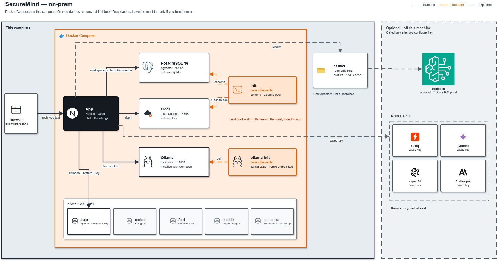
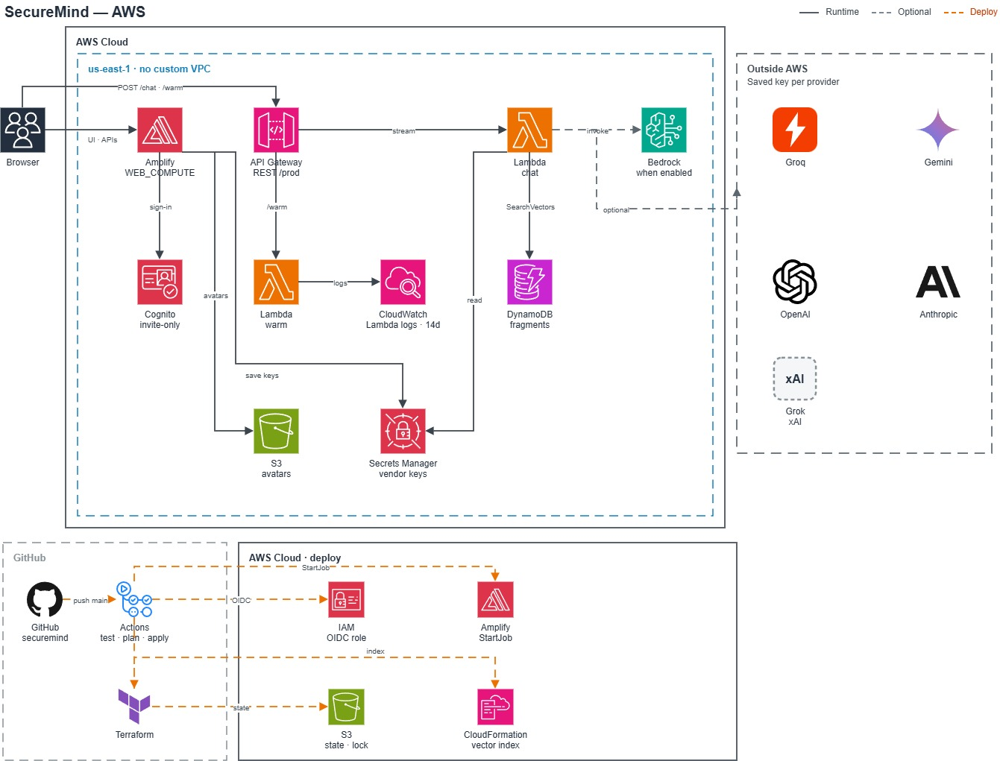

# SecureMind

A privacy-aware AI workspace for models, Knowledge, memory, cost, and sensitive-data risk.

Detection runs before chat is sent and again when Knowledge is ingested. That reduces exposure. It does not guarantee complete removal of sensitive data, and it is not a compliance program. You review what is sent and what you store.

## Where to read

| You want | Start |
|---|---|
| On this computer | [On-prem](#on-prem) below, then [docs/deploy/on-prem-docker.md](docs/deploy/on-prem-docker.md) |
| Your own AWS account, from zero | [docs/deploy/aws-from-zero.md](docs/deploy/aws-from-zero.md) |
| Your own AWS account, condensed reference | [AWS](#aws) below, then [infra/README.md](infra/README.md) |
| Diagram sources | [on-prem](docs/diagrams/securemind-onprem.drawio) · [AWS](docs/diagrams/securemind-aws.drawio) |
| Longer write-ups | [Feature Guide](docs/SecureMind-Feature-Guide.docx) · [Technical Guide](docs/SecureMind-Technical-Guide.docx) |

## Models

| Where | What runs with nothing else configured |
|---|---|
| Docker Compose | Ollama (`llama3.2:3b` chat, `nomic-embed-text` embeddings) |
| Your AWS account | No model, until Bedrock is enabled for that account or an admin saves a vendor key |

Groq, Gemini, OpenAI, Anthropic, and Grok run only after a key is saved. Bedrock runs only when that account is allowed to invoke it. A saved key is not selected for you.

## What to expect

- Detection is pattern-based and can miss values. There is no path that restores a replaced value.
- One operator directory. It is not multi-tenant hosting.
- Two-step verification with an authenticator app is optional on the hosted edition and recommended for admins. The local Docker sign-in does not support it. See [docs/mfa.md](docs/mfa.md).
- Citations come from Knowledge you ingested. Conversation history is not a source.
- The hosted data store is DynamoDB. Local Docker uses Postgres with pgvector.

## On-prem



Docker Compose on this computer. Postgres, local sign-in, and Ollama come up together. Chat uses the models Compose installs. Cloud model APIs and Bedrock are optional.

### Prerequisites

- [Git](https://git-scm.com/downloads)
- [Docker](https://docs.docker.com/get-docker/) with Compose v2. The command is `docker compose`, with a space.
- About 8 GB of free disk. The first start downloads container images plus `llama3.2:3b` and `nomic-embed-text`.
- Enough free memory for a 3B chat model. 8 GB of RAM on the machine is a practical floor.
- These ports free: `3000` (app), `5432` (Postgres), `4566` (local sign-in), `11434` (Ollama).

No AWS account and no model API key.

### Run

```bash
git clone https://github.com/OrieBound/securemind.git
cd securemind
docker compose -f docker-compose.yml -f docker-compose.pull.yml pull
docker compose -f docker-compose.yml -f docker-compose.pull.yml up --no-build
```

### Confirm

Open http://localhost:3000 and create the first owner with an email and password you choose. There is no demo account. The first start can sit on the model download for a while. Later starts reuse those models.

To build the app image yourself instead of pulling it:

```bash
docker compose up --build
```

### Stop

```bash
docker compose down       # keep your data and models
docker compose down -v    # deletes the database, uploads, and models
```

Ports, backups, and optional keys: [docs/deploy/on-prem-docker.md](docs/deploy/on-prem-docker.md).

## AWS



You clone this repo and apply Terraform in an account you administer. The hosted install has no model until that account can call Bedrock, or you save a vendor key. This repository’s GitHub Actions pipeline deploys the maintainer sandbox. Your install uses your own state bucket, role, and GitHub environment.

These resources can incur AWS charges. Remove them with `npm run infra:down -- --yes` when you are finished.

### Prerequisites

- An [AWS account](https://aws.amazon.com/) you administer. Keep the app out of an organization management account.
- [AWS CLI](https://docs.aws.amazon.com/cli/latest/userguide/getting-started-install.html) version 2, with a named profile (`aws configure` or IAM Identity Center).
- [Terraform 1.14](https://developer.hashicorp.com/terraform/install) or newer. State locking uses an S3 lock file.
- [Node.js 20](https://nodejs.org/) or newer. The apply scripts package the chat Lambda.
- [Git](https://git-scm.com/downloads)
- A GitHub repository you control, so you can connect the Amplify GitHub App to your copy.
- Permission in that account to create IAM, S3, Lambda, API Gateway, Cognito, Amplify, DynamoDB, Secrets Manager, and CloudFormation.
- For a model with no vendor key: [Bedrock model access](https://docs.aws.amazon.com/bedrock/latest/userguide/model-access-modify.html) for Titan Text Embeddings v2 and a chat model you will use. Access in the console is separate from IAM.

The example region is `us-east-1`.

### Run

```bash
git clone https://github.com/OrieBound/securemind.git
cd securemind
```

Then follow [infra/README.md](infra/README.md): bootstrap the state bucket and deploy role, set three GitHub variables, connect Amplify, and apply.

### Confirm

The user pool starts empty. The setup code from Terraform is not the password. You choose the email and password on the site.

## Contributing on the host

Node.js 20 or newer.

```bash
npm install
cp .env.example .env.local
docker compose up -d db floci ollama ollama-init
npx prisma migrate deploy
npm run dev
```

## Scripts

| Command | Purpose |
|---|---|
| `npm run dev` | Dev server (port 3000) |
| `npm test` | Vitest |
| `npm run docker:onprem` | Full Compose stack, built from this repo |
| `npm run infra:up` | Apply Terraform in the account your `.env.deploy` profile points at |
