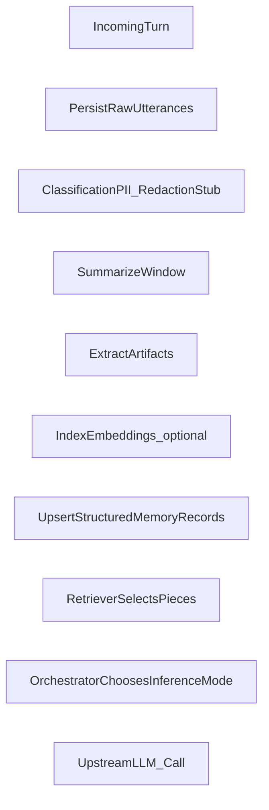

## ADR 0001: Conversation ingestion → memory → retrieval pipeline

**Status**: Proposed (Phase B target) · **Last updated**: 2026-05-12 · **Audience**: Backend + cognition architecture

---

### Context

SecureMind distinguishes itself through retrieval-driven cognition and inspectable governance. Conversations cannot be pasted wholesale into prompts; structured artifacts must summarize, sanitize, summarize again at longer horizons, and become retrievable memory that the intelligence panel reflects accurately.

Phase A intentionally mocks this path. Phase B onward needs a repeatable pipeline resilient to cost spikes and eventual AWS hardening.

### Decision drivers

| Driver | Requirement |
|--------|-------------|
| Transparency | Persist enough metadata so the intelligence panel can display sources, rationales, and confidence surrogates. |
| Cost | Route cheap models or local adapters for churn-prone summarize/extract/embed steps; escalate only strategic turns. |
| Security | Inspect content before committing durable memory entries; propagate policy decisions downstream. |

### Proposal (conceptual phases)

High-level flow aligns with PRODUCT_THESIS:



1. **Ingest**: append encrypted-at-rest payloads (eventually KMS-assisted) tying user/assistant spans to deterministic IDs.
2. **Policy scrub**: heuristic or service-backed scan (later Comprehend/Guardrails) producing allow/deny + redacted text snapshot.
3. **Summarize & extract**: deterministic cheap model summarizes recent window; emits structured stubs (preference hints, factual clauses, episodic gist). Avoid mixing identity updates without extra validation.
4. **Index**: embeddings land in Aurora/pgvector or OpenSearch; episodic blobs stay queryable independently.
5. **Retrieve orchestration**: concatenate **Layer 1 (Core identity)** + **Layer 2 (Working)** + top-k semantic hits annotated with rationales/confidence placeholders.
6. **Audit**: asynchronous trail logging memory writes, approvals, retrieves, injections blocked.

### Interfaces (non-binding stubs)

Define server-side primitives before wiring providers:

```ts
// Conceptual pseudocode boundaries
declare function persistTurn(evt: ConversationEvent): Promise<TurnReceipt>;
declare function sanitizeForMemory(raw: ConversationSpan): PolicyResult;
declare function summarize(span: ConversationSpan[]): SummaryBlob;
declare function deriveMemoryArtifacts(summary: SummaryBlob): MemoryDraft[];
declare function approveOrReject(draftId: MemoryDraft["id"], action: Approval): Promise<void>;
declare function recallContext(query: CognitiveQuery): RetrievalBundle;
declare function orchestrateInference(bundle: RetrievalBundle): ModelInvocationPlan;
```

### Out of scope (for Phase B MVP)

Multi-tenant billing, KMS key rotation narratives, federation with external MCP tools, exhaustive graph projections.

### Follow-ups once pipeline ships

Replay intelligence panel telemetry off persisted spans, implement confidence scoring using embedding distance + heuristic agreement, tighten Bedrock policy templates, expose developer-only audit explorers.
