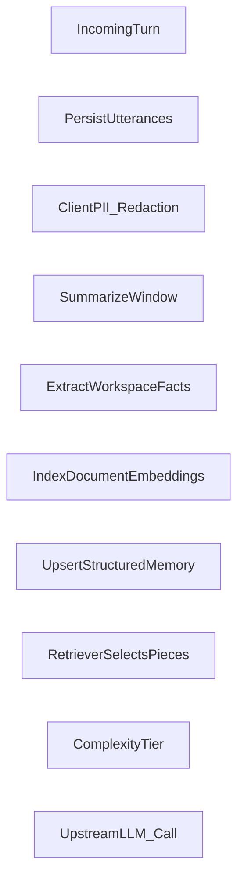

## ADR 0001: Conversation ingestion → memory → retrieval pipeline

> **Superseded in part.** Hosted storage is DynamoDB with native vectors (ADR 0007) and infrastructure is Terraform (ADR 0008). Aurora and OpenSearch below are history.

**Status**: Partially shipped · **Last updated**: 2026-08-03 · **Audience**: Backend + cognition architecture

---

### Context

SecureMind distinguishes itself through retrieval-driven cognition. Conversations cannot be pasted wholesale into prompts; structured artifacts must summarize, sanitize, and become retrievable memory that Insights and Memory views can show accurately.

Summarization, Knowledge ingest with scrubbing, and document embeddings are live. LLM-as-judge claim verification and hosted AWS hardening remain future work (see AGENTS.md).

### Decision drivers

| Driver | Requirement |
|--------|-------------|
| Transparency | Persist enough metadata so Insights can display sources and confidence surrogates. |
| Cost | Route cheap models or local adapters for summarize/extract/embed; escalate only strategic turns. |
| Security | Scrub before durable memory; never persist raw detected values. |

### Pipeline (conceptual)

High-level flow:



1. **Ingest**: append encrypted-at-rest payloads (eventually KMS-assisted) tying user/assistant spans to deterministic IDs.
2. **Policy scrub**: heuristic or service-backed scan (later Comprehend/Guardrails) producing allow/deny + redacted text snapshot.
3. **Summarize & extract**: deterministic cheap model summarizes recent window; emits structured stubs (preference hints, factual clauses, episodic gist). Avoid mixing identity updates without extra validation.
4. **Index**: embeddings land in Aurora/pgvector or OpenSearch; episodic blobs stay queryable independently.
5. **Retrieve orchestration**: concatenate **Layer 1 (Core identity)** + **Layer 2 (Working)** + top-k semantic hits annotated with rationales/confidence placeholders.
6. **Audit**: asynchronous trail logging memory writes, approvals, retrieves, injections blocked.

### Interfaces (non-binding stubs)

Define server-side primitives before wiring providers:

```ts
// Conceptual pseudocode boundaries
declare function persistTurn(evt: ConversationEvent): Promise<TurnReceipt>;
declare function sanitizeForMemory(raw: ConversationSpan): PolicyResult;
declare function summarize(span: ConversationSpan[]): SummaryBlob;
declare function deriveMemoryArtifacts(summary: SummaryBlob): MemoryDraft[];
declare function approveOrReject(draftId: MemoryDraft["id"], action: Approval): Promise<void>;
declare function recallContext(query: CognitiveQuery): RetrievalBundle;
declare function orchestrateInference(bundle: RetrievalBundle): ModelInvocationPlan;
```

### Out of scope (for Phase B MVP)

Multi-tenant billing, KMS key rotation narratives, federation with external MCP tools, exhaustive graph projections.

### Follow-ups once pipeline ships

Replay intelligence panel telemetry off persisted spans, implement confidence scoring using embedding distance + heuristic agreement, tighten Bedrock policy templates, expose developer-only audit explorers.
